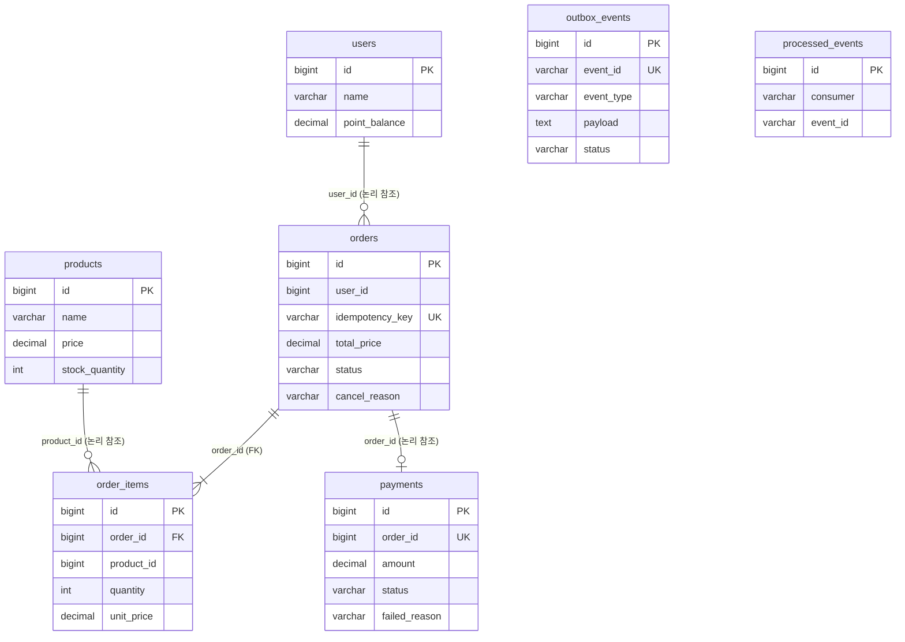

<div align="center">

# ☕ Mega-Traffic Order API

**주문이 한꺼번에 몰려도, 서버가 중간에 죽어도 재고와 포인트가 틀리지 않는 카페 주문·결제 백엔드**

Saga · Transactional Outbox · 멱등 컨슈머 · 조건부 UPDATE · 부하 측정 기반 병목 개선

<br>


</div>

<br>

## 📌 한눈에 보기

| 🛡️ 초과 판매 | 💥 장애 주입 | 🚀 주문 처리 한계 | ⏱️ 접수 → 결과까지 |
|:---:|:---:|:---:|:---:|
| **0건** | **5회 모두 장부 일치** | **초당 9건 → 38건+** | **89.5초 → 1초 미만** |
| 재고 100개에 200명 동시 주문 | 앱 강제 종료 3 · RabbitMQ 재시작 2<br>재배달 중복 9건 모두 차단 | Outbox Relay 병목을 측정으로 찾아 개선<br>(초당 40건에서도 포화 없음) | 초당 20건 주문 기준 p95<br>(3회 교대 측정 중앙값) |

| ↩️ 결제 실패 보상 | 🔁 중복 메시지 | ⚡ 정합성 비용 |
|:---:|:---:|:---:|
| 재고 **100% 복구** | **1회만 반영** | **사실상 0** |
| 10 → 7 → **10** | 동시 중복 5라운드 정확히 5회 | 보호 없는 방식과 처리량 동일 (251.7 vs 246.7 RPS) |

> [!NOTE]
> 처리량 목표(초당 N건)를 선언하는 대신, 로컬 환경에서도 검증할 수 있는 **정합성 지표**를 성공 기준으로 삼았다. 처리량과 응답 시간은 측정값과 테스트 조건을 함께 기록한다. 모든 수치는 노트북 한 대(i5-1335U)에서 앱·DB·브로커·k6를 함께 띄워 잰 값이라 **절대값보다 전후 비교**로 읽어야 한다.

<br>

## 📖 목차

1. [프로젝트 개요](#-프로젝트-개요)
2. [시스템 아키텍처](#-시스템-아키텍처)
3. [Saga 흐름](#-saga-흐름)
4. [정합성 설계](#-정합성-설계)
5. [재고 동시성 제어: 측정으로 결정하기](#-재고-동시성-제어-측정으로-결정하기)
6. [주문 흐름 부하 테스트와 병목 개선](#-주문-흐름-부하-테스트와-병목-개선)
7. [장애 주입 테스트: 서버가 죽어도 장부가 맞는가](#-장애-주입-테스트-서버가-죽어도-장부가-맞는가)
8. [모니터링](#-모니터링)
9. [API](#-api)
10. [데이터베이스](#-데이터베이스)
11. [패키지 구조와 도메인 규칙](#-패키지-구조와-도메인-규칙)
12. [트러블슈팅](#-트러블슈팅)
13. [알려진 한계](#-알려진-한계)
14. [로컬 실행](#-로컬-실행)
15. [진행 현황](#-진행-현황)

<br>

## 🎯 프로젝트 개요

대형 카페(메가커피 스타일)에서 점심시간처럼 주문이 몰리는 상황을 가정했다. 주문 하나는 **재고 차감 → 포인트 결제 → 주문 확정**을 거치는데, 동시에 수백 건이 들어오고 중간에 실패나 서버 장애가 생겨도 장부가 맞아야 한다.

| 위험 | 이 프로젝트의 해결 |
|---|---|
| 재고 하나를 여러 명이 동시에 사서 **초과 판매** | 원자적 조건부 UPDATE (k6로 5가지 방식 비교 후 결정) |
| 결제가 실패했는데 **재고는 차감된 채** 남음 | Saga + 보상 트랜잭션 (재고 복구) |
| DB는 저장됐는데 **이벤트가 유실**됨 | Transactional Outbox + Relay |
| 같은 이벤트가 두 번 와서 **두 번 차감** | 멱등 컨슈머 (`processed_events`) |
| 앱이 응답을 못 받아 재시도해서 **주문이 두 개** | `Idempotency-Key` + unique 제약 |

### 왜 모듈러 모놀리스인가

- 처음부터 서버를 나누면 네트워크와 인프라 관리 비용이 커진다. **하나의 애플리케이션 안에서 도메인 패키지를 엄격히 나누고**, 도메인 간 상태 변경은 RabbitMQ 이벤트로만 한다. 나중에 서버를 나눠도 메시징 경계는 그대로 쓸 수 있다.
- MySQL은 하나지만 **Saga 각 단계는 독립된 로컬 트랜잭션으로 커밋**한다. 그래야 앞 단계를 되돌리는 보상 트랜잭션이 실제로 의미를 가진다.

<br>

## 🏗️ 시스템 아키텍처


| 구성 요소 | 역할 |
|---|---|
| **order / product / payment** | 각자 자기 테이블만 바꾼다. 다른 도메인에 영향을 주는 일은 이벤트로 알린다 |
| **outbox_events** | 업무 데이터와 같은 트랜잭션에 저장되는 "보낼 편지" |
| **Outbox Relay** | `READY` 편지를 최대 100통씩 **배치로 발행**하고, 브로커 확인(confirm)을 받고 큐로 들어간 것만 `PUBLISHED`로 표시. 배치가 꽉 차면 쉬지 않고 다음 배치, 아니면 100ms 쉼 |
| **processed_events** | 컨슈머별로 처리한 이벤트를 기록해 중복 처리를 막음 |
| **DLQ** | 재시도를 다 쓰거나 형식이 잘못된 메시지를 보관. `x-death` 헤더에 원래 큐가 남음 |
| **Prometheus · Grafana** | 앱과 RabbitMQ 지표를 5초마다 수집. 부하·장애 테스트에서 병목과 회복을 관찰 |

<br>

## 🔄 Saga 흐름

중앙 지휘자 없이 각 도메인이 앞 단계의 이벤트를 듣고 움직이는 **코레오그래피** 방식이다. 모든 화살표는 **"커밋 → Outbox → Relay → 큐 → 컨슈머"** 를 거친다.

### 성공 흐름


### 실패 흐름: 포인트 부족 → 재고 복구


| 실패 지점 | 이벤트 | 보상 | 주문 결과 |
|---|---|---|---|
| 재고 부족 · 없는 상품 | `StockReserveFailed` | 없음 (예약 트랜잭션이 통째로 롤백됨) | `CANCELED` / `OUT_OF_STOCK` |
| 포인트 부족 · 없는 회원 | `PaymentFailed` | **재고 복구** (상품 ID 오름차순, `stock + 수량`) | `CANCELED` / `PAYMENT_FAILED` |

> [!IMPORTANT]
> 실패 기록(`TX-B`)은 반드시 **롤백된 업무 트랜잭션(`TX-A`) 밖에서, 다른 클래스의 새 트랜잭션**으로 남긴다. 같은 트랜잭션에서 저장하면 롤백과 함께 사라져 아무도 실패를 모르게 된다.

### 주문 상태


- 이벤트는 큐마다 따로 와서 **도착 순서가 보장되지 않는다.** 그래서 `PaymentCompleted`가 `StockReserved`보다 먼저 와도 확정할 수 있다.
- 이미 끝난 주문(`COMPLETED`, `CANCELED`)에 늦게 온 이벤트는 예외 대신 **무시하고 ack**한다. 예외로 처리하면 재시도 끝에 DLQ로 가서 진짜 장애와 구분이 안 된다.

<br>

## 🛡️ 정합성 설계

| # | 막는 문제 | 방법 | 검증 |
|:---:|---|---|---|
| 1 | 이벤트 유실 | Transactional Outbox | RabbitMQ 재시작 중 발행 실패 662·705건이 `READY`로 남았다가 전부 재발행 |
| 2 | 이벤트 중복 처리 | 멱등 컨슈머 (조회 + unique 두 겹) | 동시 중복 5라운드 정확히 5회 반영, 앱 강제 종료 후 재배달 중복 9건 차단 |
| 3 | 처리 불가 메시지 | 실패 분류 + 재시도 + DLQ | 헤더 누락·형식 오류는 즉시, 기술 실패는 3회 후 DLQ |
| 4 | API 중복 요청 | `Idempotency-Key` + unique | 앱이 죽은 동안 같은 키 재시도 1만여 건 → 주문 수 = 고유 키 수 |
| 5 | 주문 상태 덮어쓰기 | 주문 행 잠금 (`SELECT ... FOR UPDATE`) | 늦은 이벤트를 직접 주입해 상태 유지 확인 |

<details>
<summary><b>1. Transactional Outbox — 이벤트를 잃어버리지 않기</b></summary>

<br>

**문제**: DB 저장과 메시지 전송은 한 트랜잭션으로 묶을 수 없다.

| 순서 | 위험 |
|---|---|
| 저장 → 전송 | 저장 후 전송 전에 서버가 죽으면 이벤트 유실, 주문이 `PENDING`에 갇힘 |
| 전송 → 저장 | 전송 후 저장이 롤백되면 없는 주문의 이벤트가 돌아다님 |

**해결**
- 업무 데이터와 `outbox_events`를 **같은 트랜잭션**에 저장한다. 커밋되면 둘 다 있고, 롤백되면 둘 다 없다.
- `OutboxEventRecorder`는 `Propagation.MANDATORY`라서 트랜잭션 밖에서 부르면 바로 예외가 난다.
- Relay는 publisher confirm(브로커가 받았는지)과 mandatory(큐까지 갔는지)를 **둘 다** 확인한 뒤에만 `PUBLISHED`로 바꾼다.

**결과**: 최소 한 번은 반드시 간다. 대신 두 번 갈 수 있다 → 2번에서 막는다.

</details>

<details>
<summary><b>2. 멱등 컨슈머 — 같은 이벤트를 두 번 처리하지 않기</b></summary>

<br>

컨슈머는 `processed_events (consumer, event_id)`에 처리 기록을 남긴다. 같은 이벤트를 여러 컨슈머가 받으므로 `event_id` 단독이 아니라 컨슈머 이름과 묶는다.

| 단계 | 거르는 중복 | 로그 |
|---|---|---|
| 1차: 존재 조회 | 재전송처럼 이미 커밋된 중복 (대부분) | INFO |
| 2차: unique 제약 | 같은 순간에 와서 둘 다 조회를 통과한 중복 | Hibernate ERROR 1줄 + INFO |

- **처리 기록은 업무와 같은 트랜잭션에, 업무보다 먼저** INSERT한다. 둘이 같이 커밋되거나 같이 롤백되고, 동시에 온 두 번째 스레드는 unique 인덱스 앞에서 기다리다 업무에 들어가기 전에 탈락한다.
- **실패 경로에도 기록한다.** 업무 트랜잭션이 롤백되면 처리 기록도 사라지므로, 실패를 기록하는 새 트랜잭션에 다시 남긴다. 그렇지 않으면 재고가 채워진 뒤 재전송된 이벤트가 취소된 주문의 재고를 차감한다.
- **Redis(SET NX)가 아닌 MySQL에 기록하는 이유**: Redis 키 저장과 MySQL 재고 변경은 한 트랜잭션으로 묶이지 않는다. 처리 도중 서버가 죽으면 Redis 키만 남아 재전송이 무시되고, 재고는 영영 반영되지 않는다.

</details>

<details>
<summary><b>3. 실패 분류와 DLQ — 재시도할 것과 안 할 것 나누기</b></summary>

<br>

| 실패 | 예 | 처리 |
|---|---|---|
| 업무 실패 | 재고·포인트 부족, 상품·회원 없음 | 실패 이벤트 발행 → 보상, 메시지는 ack |
| 메시지 형식 오류 | 역직렬화 불가, `eventId` 헤더 없음 | **재시도 없이** 바로 DLQ |
| 기술 실패 | DB 연결 끊김 등 | 1초 → 2초 간격 최대 3번 → DLQ |

- 재시도 사이에 쉬는 이유: 바로 다시 붙으면 또 부딪힌다 (낙관적 락 실험에서 확인).
- requeue하지 않는 이유: 계속 실패하는 메시지가 큐 앞에서 무한 반복하지 않게.
- DLQ는 공용 1개(`mega.saga.dlq`). 원래 큐는 `x-death` 헤더로 구분한다.

</details>

<details>
<summary><b>4. API 중복 요청 — Idempotency-Key</b></summary>

<br>

- 키는 **클라이언트가** 주문 버튼을 누를 때 만들고, 재시도에는 같은 키를 다시 쓴다. 서버는 요청 내용만 볼 수 있어서, 서버가 키를 만들면 재시도와 새 주문을 구분할 수 없다.
- 1차로 키를 조회하고, 2차로 `orders.idempotency_key` unique 제약이 최종 판정한다.
- 중복 요청에는 에러가 아니라 **기존 주문을 같은 `202` 응답으로** 돌려준다.

</details>

<details>
<summary><b>5. 주문 상태 Lost Update — 행 잠금</b></summary>

<br>

`StockReserved`는 결제와 주문 두 큐로 복사되어 동시에 처리된다. 주문 리스너 두 개가 같은 주문 행을 동시에 고칠 수 있다.

| 행 잠금 없음 | 행 잠금 있음 |
|---|---|
| A, B 둘 다 `PENDING` 읽음 → B가 `COMPLETED` 저장 → A가 `STOCK_RESERVED`로 덮어씀 | A가 잠그고 읽음 → B 대기 → A 커밋 → B가 최신값 읽고 `COMPLETED` |

**재고는 조건부 UPDATE, 주문 상태는 비관적 락.** 상태 전이 규칙은 조건 하나로 표현할 수 없고, 주문 한 건의 경쟁자는 두 명뿐이라 대기 비용이 작다.

</details>

<br>

## 📊 재고 동시성 제어: 측정으로 결정하기

같은 상품 한 행에 요청이 몰릴 때 쓸 방식을 **k6로 같은 조건에서 비교**하고 결정했다.

**시나리오 B** — 재고 100,000 · VU 100명 · 30초 · 3회 중앙값

| 방식 | 정합성 | RPS | p95 | 성공 / 503 |
|---|:---:|---:|---:|---:|
| 보호 없음 (비교 기준) | ❌ 7,501건 성공에 실제 차감 751건 | 246.7 | 450ms | 7,501 / 0 |
| ✅ **원자적 조건부 UPDATE** | ✅ | **251.7** | **431ms** | 7,648 / 0 |
| 비관적 락 | ✅ | 193.6 | 632ms | 5,899 / 0 |
| 낙관적 락 | ✅ | 173.1 | 789ms | 1,887 / 3,414 |
| Redisson 분산 락 | ✅ | 102.5 | 1,499ms | 3,164 / 0 |

```sql
UPDATE products
SET stock_quantity = stock_quantity - :quantity, updated_at = CURRENT_TIMESTAMP
WHERE id = :id AND stock_quantity >= :quantity
-- 영향받은 행이 0이면 재고 부족
```

**결정 근거**
1. 정합성을 지킨 방식 중 **처리량이 가장 높다.**
2. 보호 없는 방식과 처리량이 같아서 **정합성을 지키는 비용이 사실상 없다.**
3. 락 장치나 재시도 코드 없이 **SQL 한 문장**으로 끝난다.

> [!TIP]
> 한 행에 몰리면 결국 줄을 선다. 처리량은 **요청 하나가 행을 붙잡는 시간**이 정한다 (`1초 ÷ 4.0ms ≈ 250`). 조건부 UPDATE는 잠그는 구간이 "UPDATE 한 문장 → 커밋"뿐이라 가장 짧다.

<details>
<summary><b>다른 방식이 맞는 자리 · 적용 규칙</b></summary>

<br>

| 방식 | 맞는 상황 |
|---|---|
| 비관적 락 | 조건 하나로 표현할 수 없는 규칙을 확인한 뒤 바꿔야 할 때 (이 프로젝트의 주문 상태) |
| 낙관적 락 | 충돌이 드문 곳. 한 행에 몰리면 약 65%가 재시도 한도 초과로 실패했다 |
| 분산 락 | 여러 서버가 DB 밖의 자원까지 묶어서 순서를 지켜야 할 때 |

- 포인트 차감도 같은 방식 (`잔액 >= 금액` 조건부 UPDATE)
- 한 주문에 상품이 여러 개면 **상품 ID 오름차순**으로 차감한다. 모든 트랜잭션이 같은 순서로 행을 잠가 데드락을 막는다. 재고 복구도 같은 순서.

</details>

시나리오 A(재고 100에 200명 동시), 측정 조건, 회차별로 흔들린 값은 [loadtest/RESULTS.md](loadtest/RESULTS.md)에 있다.

<br>

## 🚀 주문 흐름 부하 테스트와 병목 개선

재고 차감 하나만 쟀을 때는 초당 250건이었다. 그런데 **Saga 전체(접수 → 재고 → 결제 → 확정)를 이어 붙여 재니 초당 9건에서 막혔다.** 병목은 DB가 아니라 DB에서 메시지 브로커로 넘기는 다리, **Outbox Relay**였다.

### 측정 방법

- `loadtest/order-saga.js`: 새 상품·회원을 만들고 **성공 약 70% · 재고 부족 15% · 포인트 부족 15%** 가 섞이도록 주문. 도착률 고정(constant-arrival-rate), 60초
- 부하가 끝난 뒤 진행 중 주문이 0이 될 때까지 기다리고, 이번 실행에서 만든 데이터로 판정

| 판정 | 기준 |
|:---:|---|
| ① | 상품마다 `처음 재고 − 완료 주문 수량 합 = 남은 재고` |
| ② | 회원마다 `처음 포인트 − 완료 주문 금액 합 = 남은 포인트` |
| ③ | 이번 실행 주문 중 `COMPLETED` / `CANCELED`가 아닌 것 0건 |
| ④ | DLQ 0건 |

### 1단계: 속도를 올리며 병목 찾기 (개선 전)

| 들어온 속도 | 끝난 속도 | 접수 → 완료 p95 | 판정 ①~④ |
|---:|---:|---:|:---:|
| 2건/초 | 1.9건/초 | 3.7초 | ✅ |
| 5건/초 | 4.7건/초 | 5.6초 | ✅ |
| 10건/초 | 8.4건/초 | 15.3초 | ✅ |
| 20건/초 | **8.8건/초** | **89.4초** | ✅ |

- 들어오는 양을 두 배(10 → 20)로 올려도 **끝나는 속도는 9건/초 근처에서 멈췄고**, Outbox `READY`가 858통까지 쌓였다.
- 컨슈머 큐 대기는 3건 이하, DB 커넥션 대기는 0, 접수 API p95는 40ms 안팎으로 **다른 후보는 모두 여유가 있었다.**
- 그래도 판정은 모두 통과했다. **느려져도 틀리지는 않았다.**

### 2단계: 원인 분석과 개선


| | 개선 전 | 개선 후 |
|---|---|---|
| 전송과 확인 | 한 통 보내고 확인 기다리기를 100번 | 100통 연달아 보내고 확인을 모아서 1번 |
| `PUBLISHED` 표시 | 한 통마다 UPDATE + 커밋 | 확인된 ID를 모아 UPDATE 1번 |
| 쉬는 시간 | 100통마다 1초 | 꽉 찼으면 즉시 다음 배치, 아니면 100ms |
| 비용 | 한 통 약 30ms (확인 16.8ms + 커밋 13.5ms) | 배치 1회 약 20ms, 건수와 거의 무관 |
| 이론상 한계 | 약 25통/초 → 주문 약 9건/초 | 실측 한계 미도달 |

- 유실 방지 원칙은 그대로다. **확인(ack)을 받았고 반환되지 않은 편지만** `PUBLISHED`가 되고, 나머지는 `READY`로 남아 다시 나간다.
- 대가는 **중복**이다. 표시 직전에 죽으면 배치 전체가 다시 발행될 수 있다. 이미 만든 멱등 컨슈머가 걸러내기 때문에 감수할 수 있는 선택이었다.
- 스케줄러 스레드가 하나라서, Relay가 붙잡고 있으면 다른 `@Scheduled` 작업이 못 돈다. 그래서 한 번 깨어나면 **최대 50배치**까지만 처리하고 돌려준다.

### 3단계: 같은 조건에서 전후 비교 (전 → 후 번갈아 3회, 중앙값)


<sub>15:55~16:09, 개선 전·후 RATE 20을 세 번씩 번갈아 실행. 개선 전에는 끝난 속도(노랑)가 들어온 속도(초록)를 못 따라가고 Outbox가 900 가까이 쌓인다. 개선 후에는 두 선이 붙어 있고 Outbox가 바닥에 머문다.</sub>

| RATE 20 | 개선 전 | 개선 후 |
|---|---:|---:|
| 끝난 속도 | 8.87건/초 | **19.02건/초** (들어온 만큼 처리) |
| 접수 → 완료 p95 | 89.5초 | **1초 미만** |
| 밀린 주문 다 빠지는 시간 | 75.3초 | 약 3초 (측정 최솟값) |
| Outbox `READY` 최대 | 879 | **8** |
| Relay 발행 최대 | 26.7통/초 (포화) | 57.8통/초 (여유) |
| 판정 ①~④ | 3/3 통과 | 3/3 통과 |

| RATE 2 (한가할 때) | 개선 전 | 개선 후 |
|---|---:|---:|
| 접수 → 완료 p95 | 3.7초 | **1초 미만** |

한가할 때도 빨라진 이유는, 예전에는 Saga 3단계마다 Relay 주기(최대 1초)를 기다렸고 지금은 최대 0.1초만 기다리기 때문이다.

<details>
<summary><b>다음 병목 후보 (RATE 40, 개선 후 1회)</b></summary>

<br>

초당 40건에서 끝난 속도 37.7건/초, p95 약 0.7초, 판정 통과. **포화된 곳이 없어 병목을 단정할 수는 없고**, 한계에 가까운 순서로 정리했다.

| 순위 | 후보 | 측정값 | 예상 |
|:---:|---|---|---|
| 1 | 컨슈머 (큐마다 스레드 1개) | 한 건 처리 15~17ms | 주문 약 55~65건/초에서 큐가 쌓이기 시작 |
| 2 | DB 커넥션 풀 (최대 10) | 최대 8개 사용, 대기 0 | 컨슈머 스레드를 늘리면 바로 한계 |
| — | Relay | 배치 평균 15건 / 25ms | 여유 |

병목은 없어지는 게 아니라 **옮겨 간다.** Relay → 컨슈머 → DB 커넥션 순서로 예상한다.

</details>

측정 환경: LG 15U50R 노트북, Intel i5-1335U, RAM 32GB, Windows 11, Docker Desktop. k6·앱·MySQL·RabbitMQ·Prometheus를 모두 같은 기기에서 실행. 결과 원본은 `loadtest/results/saga-*.json`.

<br>

## 💥 장애 주입 테스트: 서버가 죽어도 장부가 맞는가

Outbox와 멱등 컨슈머를 만든 진짜 이유는 **"서버가 중간에 죽어도 장부가 맞는 것"** 이다. 그래서 초당 20건 부하 도중에 일부러 죽였다.

- **앱 강제 종료 3회**: `taskkill /F` (리눅스의 `kill -9`). 정상 종료와 달리 하던 일을 마무리할 기회 없이 트랜잭션 한가운데서 끊긴다. 25 · 35 · 45초 시점, 10초 뒤 재기동
- **RabbitMQ 재시작 2회**: 30초 시점 `docker restart`
- 클라이언트(k6)는 실제 앱처럼 연결 실패·5xx에 **같은 Idempotency-Key로 재시도**

### 죽는 순간마다 지켜주는 장치

| 죽는 순간 | 생기는 일 | 지켜주는 장치 | 실제 발생 (3회 합계) |
|---|---|---|:---:|
| ① 주문 접수 트랜잭션 중 | 저장 롤백, 손님이 같은 키로 재시도 | Idempotency-Key | **2번** → 재시도로 딱 1건 생성 |
| ② Relay 전송 후 표시 전 | 재시작 후 같은 편지 재발행 | 멱등 컨슈머 | 0번 (아래 한계 참고) |
| ③ 컨슈머 처리 중 (커밋 전) | 롤백, ack 없음 → 재배달 | 처리 기록도 같이 롤백 → 정상 재처리 | 0번 |
| ④ 컨슈머 커밋 후, ack 전 | 일은 끝났는데 재배달 | 멱등 컨슈머 | **9번** → **모두 1차 조회에서 건너뜀** |

④번이 핵심 증거다. 이 장치가 없었다면 재고나 포인트가 9번 더 깎였다.

### 결과


<sub>앱이 죽은 동안 처리가 멈췄다가, 재기동 직후 끝난 속도(노랑)가 50건/초까지 솟구치며 밀린 주문을 따라잡는다.</sub>

| | 앱 1 | 앱 2 | 앱 3 | MQ 1 | MQ 2 |
|---|:---:|:---:|:---:|:---:|:---:|
| ① 재고 장부 · ② 포인트 장부 | ✅ | ✅ | ✅ | ✅ | ✅ |
| ③ 미완료 0 · ④ DLQ 0 | ✅ | ✅ | ✅ | ✅ | ✅ |
| ⑤ 주문 수 = 202 받은 고유 키 수 | 1801 = 1801 | 1801 = 1801 | 1801 = 1801 | 1800 = 1800 | 1800 = 1800 |
| ⑥ 중복 건너뜀 (앱 로그 기준) | 6 | 1 | 2 | 0 | 0 |
| 같은 키 재시도 요청 | 10,693 | 11,628 | 11,689 | 0 | 0 |
| 접수 실패 | 0 | 0 | 0 | 0 | 0 |
| 재기동 → 진행 중 0 | 45.5초 | 34.0초 | 23.7초 | 58.5초 | 58.1초 |
| 배달 유실 (확인한 배달 수) | 0 / 6,932 | 0 / 6,965 | 0 / 6,929 | 0 / 6,914 | 0 / 6,940 |

- **앱 강제 종료**: 죽어 있던 동안 회차마다 약 470건의 주문이 거절됐지만, 같은 키 재시도로 **결국 전부 한 번씩만** 접수됐다. 가장 오래 기다린 손님은 27초.
- **RabbitMQ 재시작**: 브로커가 내려간 동안 Relay의 발행 실패 662·705건이 `READY`로 남았다가 재연결 후 전부 다시 나갔다. 컨슈머 7개는 11~17초 만에 스스로 다시 붙었다.

결과 원본은 `loadtest/results/crash-*.json`, 장애 주입 스크립트는 `loadtest/crash-run.sh`.

<br>

## 📈 모니터링

**비동기 시스템에서는 응답이 빠른 것과 처리가 빠른 것이 다르다.** 주문 API는 `202`를 40ms 만에 돌려주지만, 실제 결과는 큐를 세 번 갈아탄 뒤에 나온다. k6 응답 시간만 보면 이 차이가 보이지 않아서 지표를 붙였다.

| 지표 | 종류 | 답하는 질문 |
|---|---|---|
| 들어온 속도 vs 끝난 속도 | Counter | 처리가 접수를 따라가고 있나 |
| 접수 → 완료 p95 | Timer | 손님이 결과를 받기까지 얼마나 걸리나 |
| 진행 중 주문 (`PENDING` + `STOCK_RESERVED`) | Gauge | 멈춘 주문이 있나. 부하가 끝나면 0이어야 함 |
| Outbox `READY` | Gauge | Relay가 밀리나 |
| 큐 대기 합계 · 큐별 | RabbitMQ 지표 | 어느 컨슈머가 밀리나 |
| DLQ | RabbitMQ 지표 | 처리를 포기한 메시지가 있나 |
| Relay 배치 크기·시간, 중복 건너뜀, HikariCP | 진단용 (접힌 행) | 원인을 찾을 때만 |

- 지표 이름은 모두 `mega_` 접두사. 기록 책임은 `SagaMetrics` 한 곳에 모았다.
- 완료·취소 Counter와 접수 → 완료 Timer는 **트랜잭션 커밋이 성공한 뒤(`afterCommit`)에만** 기록한다. 트랜잭션 안에서 바로 올리면 롤백되거나 재시도될 때 지표가 DB와 다른 말을 한다.
- 진행 중 주문과 Outbox `READY`는 스크레이프할 때마다 DB에서 직접 센다. 따로 숫자를 들고 있으면 실제 DB와 어긋날 수 있다.

<br>

## 🔌 API

| 구분 | Method | Endpoint | 설명 |
|---|:---:|---|---|
| 주문 | `POST` | `/api/v1/orders` | 주문 접수, `PENDING` 저장 후 **`202`** |
| 주문 | `GET` | `/api/v1/orders/{orderId}/status` | 비동기 처리 결과 폴링 |
| 상품 | `GET` | `/api/v1/products/{productId}` | 상품 조회 (재고는 항상 DB) |
| 포인트 | `GET` | `/api/v1/users/{userId}/points` | 잔액 조회 |
| 테스트 데이터 | `POST` | `/api/v1/users` | 유저 등록 |
| 테스트 데이터 | `POST` | `/api/v1/users/{userId}/points` | 포인트 충전 |
| 테스트 데이터 | `POST` | `/api/v1/products` | 상품 및 초기 재고 등록 |
| 실험용 | `POST` | `/api/v1/experiments/stock/{strategy}` | 재고 차감 방식 비교 전용. 실제 주문 흐름에서는 쓰지 않음 |

결제 API는 없다. 결제는 클라이언트가 호출하지 않고 **이벤트로 진행**된다.

<details>
<summary><b>주문 접수 요청 / 응답 예시</b></summary>

<br>

```http
POST /api/v1/orders
Idempotency-Key: 7f3c2a1e-...
Content-Type: application/json

{
  "userId": 1,
  "items": [
    { "productId": 7, "quantity": 2 },
    { "productId": 9, "quantity": 1 }
  ]
}
```

```json
// 202 Accepted
{ "orderId": 123, "status": "PENDING" }
```

```json
// GET /api/v1/orders/123/status
{ "orderId": 123, "status": "CANCELED", "cancelReason": "PAYMENT_FAILED" }
```

- 같은 `Idempotency-Key`로 다시 오면 새 주문을 만들지 않고 기존 주문을 그대로 반환한다.
- 금액은 클라이언트 값이 아니라 **서버가 현재 상품 가격으로 계산**한다.
- 접수 단계에서는 재고를 확인하지 않는다. 읽기만으로는 동시 주문을 막을 수 없어서, 판정은 실제로 차감하는 순간에만 한다.

</details>

<br>

## 🗄️ 데이터베이스



| 설계 포인트 | 이유 |
|---|---|
| 도메인 간에는 ID만 저장, 물리 FK 없음 | 도메인 결합을 낮춤. 같은 집합인 `order_items.order_id`만 실제 FK |
| `order_items.unit_price` | 주문 이후 가격이 바뀌어도 주문 금액이 흔들리지 않도록 스냅샷 |
| `processed_events (consumer, event_id)` unique | 같은 이벤트를 여러 컨슈머가 받으므로 컨슈머와 묶음 |
| `outbox_events (status, created_at)` 인덱스 | Relay의 `READY` 조회용. 한가할 때 100ms마다 조회해도 비용이 작음 |
| `outbox_events.payload`는 `text` | MySQL `json`은 소수를 double로 바꿔 저장해서 금액이 흔들림 |
| enum 컬럼은 `varchar(20)` 고정 | Hibernate 6가 MySQL 전용 `enum` 타입을 만들어서, 값 추가마다 `ALTER`가 필요해짐 |

<details>
<summary><b>전체 스키마 (DBML)</b></summary>

<br>

```dbml
Table users {
  id bigint [pk, increment]
  name varchar(50) [not null]
  point_balance decimal(12,2) [not null, default: 0]
  created_at datetime [not null]
  updated_at datetime [not null]
}

Table products {
  id bigint [pk, increment]
  name varchar(100) [not null]
  price decimal(12,2) [not null]
  stock_quantity int [not null]
  created_at datetime [not null]
  updated_at datetime [not null]
}

Table orders {
  id bigint [pk, increment]
  user_id bigint [not null]
  idempotency_key varchar(64) [not null, unique]
  total_price decimal(12,2) [not null]
  status varchar(20) [not null]         // PENDING, STOCK_RESERVED, COMPLETED, CANCELED
  cancel_reason varchar(50)             // OUT_OF_STOCK, PAYMENT_FAILED
  created_at datetime [not null]
  updated_at datetime [not null]
}

Table order_items {
  id bigint [pk, increment]
  order_id bigint [not null]
  product_id bigint [not null]
  quantity int [not null]
  unit_price decimal(12,2) [not null]   // 주문 시점 가격 스냅샷
}

Table payments {
  id bigint [pk, increment]
  order_id bigint [not null, unique]
  amount decimal(12,2) [not null]
  status varchar(20) [not null]         // SUCCESS, FAILED
  failed_reason varchar(255)
  created_at datetime [not null]
}

Table outbox_events {
  id bigint [pk, increment]
  event_id varchar(36) [not null, unique]
  aggregate_type varchar(30) [not null]    // ORDER, STOCK, PAYMENT
  aggregate_id bigint [not null]
  event_type varchar(50) [not null]
  payload text [not null]
  status varchar(20) [not null]            // READY, PUBLISHED
  created_at datetime [not null]
  published_at datetime

  indexes {
    (status, created_at) [name: 'idx_outbox_status_created']
  }
}

Table processed_events {
  id bigint [pk, increment]
  consumer varchar(50) [not null]          // 큐 이름 (예: product.order-created)
  event_id varchar(36) [not null]
  processed_at datetime [not null]

  indexes {
    (consumer, event_id) [unique, name: 'uk_processed_consumer_event']
  }
}

Ref: orders.user_id > users.id
Ref: order_items.order_id > orders.id
Ref: order_items.product_id > products.id
Ref: payments.order_id - orders.id
```

- `created_at` / `updated_at`은 `BaseTimeEntity`(JPA Auditing)를 상속한 엔티티에서 자동으로 기록된다.
- `users.point_balance` 기본값 0은 엔티티(Builder)에서 채운다. DDL에는 `DEFAULT 0`이 없으므로 SQL로 직접 INSERT할 때는 값을 명시한다.

</details>

<br>

## 📦 패키지 구조와 도메인 규칙

```
com.mega.order
 ┣ global
 ┃  ┣ config          RabbitMQ 토폴로지(Exchange · Queue · DLQ), 재시도 분류, JPA Auditing
 ┃  ┣ exception       전역 예외 처리
 ┃  ┣ monitoring      SagaMetrics (mega_* 지표 기록)
 ┃  ┣ outbox          OutboxEvent, OutboxEventRecorder, OutboxRelay
 ┃  ┗ idempotency     ProcessedEvent, ProcessedEventRecorder, DuplicateEventGuard
 ┣ user               회원, 포인트 조회/충전, PointDeductor
 ┣ product            상품, 재고 예약/복구, StockReservationFailureRecorder
 ┃  ┗ messaging       OrderCreated · PaymentFailed 컨슈머
 ┣ order              주문 접수, 상태 조회, 확정/취소
 ┃  ┗ messaging       StockReserved · PaymentCompleted · StockReserveFailed · PaymentFailed 컨슈머
 ┗ payment            결제 기록, PaymentFailureRecorder
    ┗ messaging       StockReserved 컨슈머
```

| 규칙 | 내용 |
|---|---|
| 🚫 직접 호출 금지 | 다른 도메인의 상태를 바꾸는 일은 **이벤트로만** 한다 |
| 👀 읽기는 Reader로 | `ProductReader`(id, 가격), `UserReader`(존재 여부)처럼 필요한 것만 담은 좁은 창구로 읽는다 |
| ⚠️ 유일한 예외 | `PointDeductor` — 포인트 차감과 결제 기록은 한 트랜잭션이어야 해서 user가 제공하는 쓰기 창구 하나만 연다. `MANDATORY`로 결제 트랜잭션 안에서만 쓰인다. 서버를 나누면 포인트 잔액을 payment로 옮긴다 |
| 🧱 트랜잭션 경계 | 예외를 잡아야 하는 쪽(Facade, 리스너)은 트랜잭션 **밖**, 트랜잭션은 **다른 클래스**에 둔다. 같은 클래스 내부 호출은 프록시를 거치지 않아 `@Transactional`이 적용되지 않는다 |

<br>

## 🔧 트러블슈팅

| # | 문제 | 유형 | 한 줄 요약 |
|:---:|---|:---:|---|
| 1 | [부하 테스트 중 연결 거부](#ts-1) | 🔥 실제 | Tomcat 연결 대기열(100)이 넘쳐 요청이 서버에 닿지 못함 |
| 2 | [STRING enum이 MySQL enum 컬럼으로 생성](#ts-2) | 🔥 실제 | 값 추가마다 `ALTER`가 필요해지는 구조 |
| 3 | [금액 초과 예외가 중복 주문으로 오인](#ts-3) | 🔥 실제 | 예외를 넓게 잡아 엉뚱한 경로로 처리됨 |
| 4 | [조건부 UPDATE가 `updated_at`을 갱신 안 함](#ts-4) | 🔥 실제 | 벌크 UPDATE는 JPA Auditing을 거치지 않음 |
| 5 | [RabbitMQ 큐가 생성되지 않음](#ts-5) | 🔥 실제 | 선언은 첫 연결 시점에 실행됨 |
| 6 | [Outbox payload 금액이 double로 바뀜](#ts-6) | 🔥 실제 | MySQL `json` 타입의 숫자 변환 |
| 7 | [메시지 전송 실패를 성공으로 착각](#ts-7) | 🛡️ 예방 | "보냈다"와 "큐에 들어갔다"는 다름 |
| 8 | [이벤트끼리 주문 상태를 덮어씀](#ts-8) | 🛡️ 예방 | 서로 다른 큐의 Lost Update |
| 9 | [실패 메시지 무한 재전송](#ts-9) | 🛡️ 예방 | 재시도 제한과 실패 분류 |
| 10 | [DLQ 설정 후 PRECONDITION_FAILED](#ts-10) | 🔥 실제 | 선언이 실패했는데 앱은 정상 기동 |
| 11 | [Saga 전체 처리량이 초당 9건에서 막힘](#ts-11) | 🔥 실제 | 병목은 DB가 아니라 Outbox Relay |
| 12 | [옛날 데이터 때문에 "멈춘 주문 0" 판정 불가](#ts-12) | 🔥 실제 | 전역 지표는 과거 데이터까지 센다 |
| 13 | [끝난 그래프가 평평하게 이어져 앱이 죽은 줄 오해](#ts-13) | 🔥 실제 | 미래까지 잡힌 시간 범위와 Prometheus 조회 방식 |
| 14 | [앱 재시작 후 Counter 증가분을 놓침](#ts-14) | 🔥 실제 | 메모리 속 지표는 프로세스와 함께 사라진다 |

<a id="ts-1"></a>
<details>
<summary><b>1. 부하 테스트 중 연결 거부</b> 🔥</summary>

<br>

**증상**
- k6로 연결 200개를 동시에 열면(시나리오 A) 200건 중 49~76건이 서버에 닿지 못했다.
- `connectex: No connection could be made because the target machine actively refused it.`

**원인 추정**
- Tomcat 연결 대기열(`server.tomcat.accept-count`) 기본값이 100이다. 연결이 한꺼번에 몰려 대기열이 넘친 것으로 본다.
- Linux는 넘친 연결 요청을 버리고 클라이언트가 다시 시도하게 하지만, Windows는 즉시 거부한다.
- 동시 연결 100개인 시나리오 B에서는 한 번도 나오지 않았다.

**조치**: `server.tomcat.accept-count: 1000`. 이후 측정 30회에서 연결 실패 0건.

**배운 점**
- 트래픽이 몰리면 비즈니스 로직보다 **연결을 받는 단계가 먼저 막힐 수 있다.**
- 응답 코드뿐 아니라 "요청이 서버에 닿았는지"도 따로 세어야 결과를 믿을 수 있다.

</details>

<a id="ts-2"></a>
<details>
<summary><b>2. STRING enum이 MySQL enum 컬럼으로 생성</b> 🔥</summary>

<br>

**증상**: `@Enumerated(EnumType.STRING)`인데 `ddl-auto`가 `status`를 `enum('PENDING', ...)` 타입으로 만들었다. Java enum에 값을 추가할 때마다 `ALTER TABLE`이 필요해진다.

**원인**: Hibernate 6의 `MySQLDialect`는 STRING enum을 MySQL 전용 `enum` 타입으로 선언한다.

**조치**: enum 필드마다 `@Column(columnDefinition = "varchar(20)")`로 타입을 고정.

**배운 점**: ORDINAL을 피한 이유와 같은 문제가 DB 쪽에서 모양만 바꿔 반복될 수 있다. **실제로 만들어진 컬럼 타입까지 확인한다.**

</details>

<a id="ts-3"></a>
<details>
<summary><b>3. 금액 초과 예외가 중복 주문으로 오인</b> 🔥</summary>

<br>

**증상**: 총액이 `decimal(12,2)` 범위를 넘으면 INSERT에서 `DataIntegrityViolationException`이 났고, `OrderFacade`가 이를 Idempotency-Key 중복으로 보고 처리하다 결국 500이 됐다.

**원인**: 이 예외는 unique 위반뿐 아니라 값 범위 초과 같은 다른 제약 위반에도 쓰인다.

**조치**: `Order` 생성자에서 총액 범위를 검증해 INSERT 전에 400으로 응답한다.

**배운 점**: 예외를 넓게 잡으면 다른 원인의 예외가 엉뚱한 처리 경로로 들어간다. 이후 멱등 컨슈머에서는 **제약 이름까지 확인**해서 `processed_events`의 unique 위반만 중복으로 취급했다.

</details>

<a id="ts-4"></a>
<details>
<summary><b>4. 조건부 UPDATE가 updated_at을 갱신 안 함</b> 🔥</summary>

<br>

**원인**: `@Query` 벌크 UPDATE는 엔티티를 거치지 않아 JPA Auditing(`@LastModifiedDate`)이 동작하지 않는다.

**조치**: 쿼리에 `updatedAt = CURRENT_TIMESTAMP`를 직접 넣었다. 재고 차감·복구, 포인트 차감 모두 같은 방식.

**배운 점**: 벌크 UPDATE를 쓰면 엔티티 기반 기능이 빠진다는 것을 같이 챙긴다.

</details>

<a id="ts-5"></a>
<details>
<summary><b>5. RabbitMQ 큐가 생성되지 않음</b> 🔥</summary>

<br>

**증상**: Exchange·Queue·Binding을 빈으로 선언했는데 RabbitMQ에 아무것도 생기지 않았다.

**원인**: `RabbitAdmin`은 **처음 연결될 때** 선언을 실행한다. 당시에는 컨슈머가 없고 Relay도 보낼 이벤트가 없어 연결 자체가 없었다.

**조치**: 기동 시 `AmqpAdmin.initialize()`로 직접 선언하게 했다가, 컨슈머가 생겨 기동 시점에 연결되자 그 코드를 지웠다.

**배운 점**: 선언 코드가 있어도 **언제 실행되는지** 확인한다. 우회 코드는 필요했던 조건이 사라지면 같이 지운다.

</details>

<a id="ts-6"></a>
<details>
<summary><b>6. Outbox payload 금액이 double로 바뀜</b> 🔥</summary>

<br>

**증상**: 총액 `6001.00`이 메시지에 `"totalPrice": 6001.0`으로 담겼다.

**원인**: MySQL은 `json` 컬럼에 저장할 때 소수가 있는 숫자를 double로 바꾼다.

**조치**: 컬럼을 `text`로 바꿔 직렬화한 문자열을 그대로 저장. `ddl-auto: update`는 기존 컬럼 타입을 바꾸지 않아서 `ALTER TABLE`로 직접 변경했다. 이후 `8469.40`이 그대로 전송되는 것을 확인.

**배운 점**: 코드에서 BigDecimal을 써도, 저장·전송 경로 중 한 곳에서 double을 거칠 수 있다.

</details>

<a id="ts-7"></a>
<details>
<summary><b>7. 메시지 전송 실패를 성공으로 착각</b> 🛡️</summary>

<br>

**예상 증상**: Relay가 `PUBLISHED`로 바꿨는데 실제로는 어느 큐에도 메시지가 없어 이벤트가 사라짐.

**원인**: `RabbitTemplate.send()`는 결과를 기다리지 않는다. 브로커가 못 받았거나 연결된 큐가 없어 버려져도 호출은 정상으로 끝난다.

**조치**
- publisher confirm(`correlated`)으로 브로커 수신 확인
- mandatory + publisher-returns로 큐까지 전달됐는지 확인
- 확인을 최대 5초 기다리고, 둘 다 통과했을 때만 `PUBLISHED`

**배운 점**: "보냈다"와 "브로커가 받아 큐에 넣었다"는 다르다. Outbox의 유실 방지는 이 둘을 구분해야 성립한다.

</details>

<a id="ts-8"></a>
<details>
<summary><b>8. 이벤트끼리 주문 상태를 덮어씀</b> 🛡️</summary>

<br>

**예상 증상**: 결제까지 끝난 주문이 `COMPLETED`가 아니라 `STOCK_RESERVED`로 남음.

**원인**: `StockReserved`와 `PaymentCompleted`는 다른 큐에서 다른 스레드가 처리한다. 둘 다 `PENDING`을 읽으면 늦게 저장한 쪽이 덮어쓴다.

**조치**: `findByIdForUpdate`(`PESSIMISTIC_WRITE`)로 주문 행을 잠근다. 이미 끝난 주문에 온 이벤트는 반영하지 않고 정상 처리한다.

**배운 점**: 재고는 조건부 UPDATE, 주문 상태는 비관적 락. 규칙을 확인한 뒤 바꿔야 하고 경쟁이 작을 때는 비관적 락이 맞다.

</details>

<a id="ts-9"></a>
<details>
<summary><b>9. 실패 메시지 무한 재전송</b> 🛡️</summary>

<br>

**예상 증상**: 처리할 수 없는 메시지 하나가 같은 실패를 끝없이 반복하며 로그와 브로커, DB에 부하를 줌.

**원인**: Spring AMQP 기본 설정은 리스너 예외 시 메시지를 다시 큐에 넣는다.

**조치**
- 재시도 최대 3번(1초, 2초 간격), 이후 `SagaMessageRecoverer`가 ERROR 로그 후 requeue 없이 reject → DLQ
- 업무 실패는 리스너가 직접 잡아 실패 이벤트를 발행하고 ack
- 형식 오류(역직렬화 불가, `eventId` 헤더 없음)는 재시도 없이 바로 DLQ

**배운 점**: 일시적 오류와 비즈니스 실패는 처리 경로를 나눠야 한다.

</details>

<a id="ts-10"></a>
<details>
<summary><b>10. DLQ 설정 후 PRECONDITION_FAILED</b> 🔥</summary>

<br>

**증상**: 기존 큐 7개에 `x-dead-letter-exchange`를 추가하자 선언 에러가 반복됐다.

```
PRECONDITION_FAILED - inequivalent arg 'x-dead-letter-exchange' for queue 'product.order-created' in vhost '/':
received the value 'mega.saga.dlx' of type 'longstr' but current is none
```

**그런데도 앱은 `Started`까지 정상 기동했고, 컨슈머도 7개 큐에 모두 붙었다.**

**원인**
- RabbitMQ는 이미 있는 큐를 다른 인자로 다시 선언하는 것을 허용하지 않는다.
- 선언이 첫 큐에서 멈춰 큐에 DLX 인자가 없고 DLX → DLQ 바인딩도 없었다. 컨슈머는 큐 이름만 보고 붙으므로 겉으로는 정상이었지만, reject된 메시지는 예전처럼 버려지는 상태였다.

**조치**: 앱을 멈추고 비어 있는 큐 7개를 지운 뒤 다시 기동.

```bash
docker exec mega-rabbitmq rabbitmqctl delete_queue product.order-created --if-empty
```

**배운 점**
- **앱이 떴다고 설정이 반영된 것은 아니다.** 기동 후 큐 인자와 바인딩을 직접 확인한다.
- 운영 환경이라면 큐를 지우는 대신 새 이름의 큐로 옮기거나, policy(`rabbitmqctl set_policy`)로 DLX를 지정한다.

</details>

<a id="ts-11"></a>
<details>
<summary><b>11. Saga 전체 처리량이 초당 9건에서 막힘</b> 🔥</summary>

<br>

**증상**: 주문 하나만 넣으면 2.5초면 끝나는데, 수십 건을 한꺼번에 넣으면 10초가 넘게 걸렸다. 초당 20건을 넣자 끝나는 속도가 8.8건에서 멈추고 결과까지 89초가 걸렸다.

**원인**
- 처음에는 "주문이 몰려 큐에서 줄을 선다"고 추측했지만, **큐 대기는 3건 이하**였다. 줄은 큐 앞, Outbox에 서 있었다.
- Relay 코드를 보니 편지를 **한 통 보내고 확인을 기다린 뒤 UPDATE + 커밋**하는 일을 100번 반복하고 1초 쉬었다. 한 통 30ms × 100 + 1초 → 초당 약 25통 → 주문 하나에 편지 2.85통이 필요하므로 주문 약 9건/초.
- 계산한 한계(25통/초, 9건/초)와 실측(26.7통/초, 8.8건/초)이 맞았다.

**조치**: 배치 단위로 보내고, 확인을 모아 기다리고, `PUBLISHED`를 UPDATE 1번으로 표시하고, 꽉 찼으면 쉬지 않도록 바꿨다. 같은 조건 3회 교대 측정에서 끝난 속도 8.87 → 19.02건/초, p95 89.5초 → 1초 미만.

**배운 점**
- **부분만 재서는 전체 병목을 알 수 없다.** 재고 차감은 초당 250건이었지만, 이어 붙인 흐름은 다른 곳에서 막혔다.
- 처음 세운 숫자(초당 3건 한계)는 1분 평균 그래프를 보고 낸 틀린 추정이었다. 가설은 측정으로 확인하고, 틀렸으면 고친다.
- 성능 개선이 중복을 늘리는 대가를 치를 수 있었던 건 **멱등 컨슈머가 이미 있었기 때문**이다. 앞서 만든 안전장치가 뒤의 최적화를 가능하게 했다.

</details>

<a id="ts-12"></a>
<details>
<summary><b>12. 옛날 데이터 때문에 "멈춘 주문 0" 판정 불가</b> 🔥</summary>

<br>

**증상**: 부하가 끝났는데 "진행 중 주문" 지표가 0이 아니라 10에서 멈춰 있었다.

**원인**: 지표는 DB의 모든 주문을 센다. Saga가 생기기 전(Day 3~7)에 만든 `PENDING` 8건과, 보상 로직이 생기기 전 결제가 실패한 `STOCK_RESERVED` 2건이 남아 있었다. 지금 흐름의 문제가 아니라 **과거 개발 데이터**였다.

**조치**: 측정 전에 DB를 초기화하고, 판정은 **이번 실행에서 만든 상품·회원·주문만** 대상으로 계산했다.

**배운 점**: 전역 지표로 판정하려면 시작 상태가 깨끗해야 한다. 판정 범위를 "이번 실행"으로 좁혀두면 남은 데이터에 흔들리지 않는다.

</details>

<a id="ts-13"></a>
<details>
<summary><b>13. 끝난 그래프가 평평하게 이어져 앱이 죽은 줄 오해</b> 🔥</summary>

<br>

**증상**: 측정 도중 Grafana에서 Outbox, 진행 중 주문, 큐 대기 그래프가 한 값으로 몇 분간 평평하게 이어지다 끊겼다. 앱이 죽은 것으로 판단했지만, 실제로는 같은 시간대에 측정이 정상으로 돌고 있었다.

**원인**: 대시보드 시간 범위가 **"지금"보다 미래까지** 고정돼 있었다. Prometheus는 각 시점의 값을 구할 때 최근 5분 안의 마지막 값을 쓰기 때문에, 아직 오지 않은 구간에 마지막 값을 그대로 이어 그렸다.

**조치**: 실시간 관찰은 "Last 15 minutes" 같은 상대 범위로, 특정 실행은 측정 스크립트가 기록한 from/to 범위로 연다.

**배운 점**: 평평한 선은 "값이 변하지 않음"일 수도, "새 값이 없음"일 수도 있다. 그래프 하나로 장애를 단정하지 말고 다른 근거(로그, 프로세스)와 대조한다.

</details>

<a id="ts-14"></a>
<details>
<summary><b>14. 앱 재시작 후 Counter 증가분을 놓침</b> 🔥</summary>

<br>

**증상**: 앱 강제 종료 테스트에서 앱 로그에는 중복 건너뜀이 1건 찍혔는데, Prometheus 기준 증가분은 0이었다.

**원인**: Counter는 앱 **메모리 안의** 숫자라 재시작하면 0부터 다시 센다. Prometheus는 값이 줄어들면 재시작으로 보고 보정하지만, 이번에는 죽기 전에도 1, 재시작 후 첫 수집에도 1이라 줄어든 순간을 보지 못하고 "변화 없음"으로 계산했다.

**조치**: 장애 테스트의 ⑥번 판정은 앱 로그 집계를 기준으로 삼고, Prometheus 값은 참고로만 기록했다.

**배운 점**: 프로세스 안에서 세는 지표는 프로세스가 죽으면 같이 사라진다. **장애 상황의 정확한 집계는 로그나 DB처럼 프로세스 밖에 남는 기록**으로 한다.

</details>

<br>

## ⚠️ 알려진 한계

- **Outbox Relay는 서버 1대를 가정한다.** 여러 대가 동시에 Relay를 돌리면 같은 `READY` 이벤트를 각자 발행할 수 있다. 늘릴 때는 `SELECT ... FOR UPDATE SKIP LOCKED` 등으로 조회 대상을 나눠야 한다.
- **배치 발행 이후 중복 범위가 커졌다.** 표시 직전에 죽으면 최대 100통이 다시 발행될 수 있다. 멱등 컨슈머가 걸러내지만, 장애 테스트에서 이 순간(Relay 전송 후 표시 전)에 죽은 적은 없어 **실험으로 확인하지는 못했다.** 전송부터 표시까지가 약 20ms라 맞추기 어려웠다.
- **RabbitMQ 재시작 직전 큐는 비어 있었다.** 컨슈머가 빨라 큐가 늘 비어 있어서, "큐에 남아 있던 메시지가 재시작에서 살아남는가"는 확인할 대상이 없었다. 큐는 durable, 메시지는 persistent로 설정돼 있다.
- **다음 병목은 측정하지 않았다.** 초당 40건까지 포화가 없었고, 컨슈머(큐마다 스레드 1개)와 DB 커넥션 풀(10개)을 후보로 예측만 했다.
- **없는 상품도 `OUT_OF_STOCK`으로 취소한다.** 구체적인 원인은 `StockReserveFailed`의 `reason`에 남는다. 상품 판매 중지 기능이 생기면 취소 사유를 분리한다.
- **동시 중복 이벤트는 unique 제약이 막고, 이때 Hibernate `Duplicate entry` ERROR 로그가 남는다.** 처리는 한 번만 된다. 순서대로 온 중복은 1차 조회에서 걸러져 ERROR가 남지 않는다.

<br>

## 🚀 로컬 실행

```bash
cp .env.example .env    # 값 채우기 (compose.yaml과 application.yml이 함께 사용)
docker compose up -d    # MySQL, Redis, RabbitMQ, Prometheus, Grafana
./gradlew bootRun       # 반드시 프로젝트 루트에서 실행 (.env 경로 기준)
```

| 서비스 | 포트 | 비고 |
|---|---|---|
| MySQL | `3307` | DB `mega_order`, utf8mb4, Asia/Seoul |
| Redis | `6379` | AOF 활성화 |
| RabbitMQ | `5672` / `15672` / `15692` | AMQP / 관리 UI http://localhost:15672 / Prometheus 지표 |
| Prometheus | `9090` | 앱(`host.docker.internal:8080/actuator/prometheus`)과 RabbitMQ를 5초마다 수집 |
| Grafana | `3000` | `admin` / `.env`의 `GRAFANA_ADMIN_PASSWORD`. 대시보드 "Mega Order - Saga" 자동 등록 |

- `.env`는 git에 올리지 않는다. 키 목록은 `.env.example` 참고.
- 데이터는 Docker volume에 유지된다. 초기화하려면 `docker compose down -v` (Prometheus 측정 기록도 함께 지워진다).
- Grafana 데이터소스·대시보드는 `monitoring/grafana/` 파일로 등록된다. UI에서 고친 대시보드는 저장되지 않으므로 JSON 파일을 고쳐서 커밋한다.
- `GRAFANA_ADMIN_PASSWORD`는 grafana-data 볼륨이 처음 만들어질 때만 적용된다.

<details>
<summary><b>k6 부하 · 장애 테스트 실행</b></summary>

<br>

```bash
# 재고 차감 방식 비교
k6 run -e STRATEGY=atomic -e SCENARIO=B loadtest/stock-deduction.js

# 주문 흐름 전체 (RATE = 초당 주문 수)
k6 run -e RATE=20 loadtest/order-saga.js

# 장애 주입 (앱 강제 종료 3회 + RabbitMQ 재시작 2회. 시작 전 docker compose down -v로 데이터를 지운다)
./gradlew bootJar
bash loadtest/crash-run.sh all
# 한 회만: bash loadtest/crash-run.sh app <회차> <장애 시점(초)>  /  mq <회차> <초>
```

- 재고 비교 `STRATEGY`: `none`, `atomic`, `pessimistic`, `optimistic`, `redisson`
- 재고 비교 `SCENARIO`: `A`(재고 100, 200명 동시 1회), `B`(재고 100,000, 100명 30초)
- 측정 중에는 8080에 앱이 하나만 떠 있는지 확인한다. `crash-run.sh`는 앱을 직접 띄우고 죽이므로 앱을 미리 띄워 두지 않는다 (node 필요).

</details>

<br>

## 🗓️ 진행 현황

| 주차 | 기간 | 내용 | 상태 |
|---|---|---|:---:|
| 1주차 | Day 1–2 | Docker Compose, 엔티티/ERD, 테스트 데이터 API | ✅ |
| | Day 3–4 | 주문 접수 + Idempotency-Key, 재고 차감 방식 5종 구현 | ✅ |
| | Day 5–7 | k6 비교 측정, 방식 결정 | ✅ |
| 2주차 | Day 8–9 | RabbitMQ, Outbox + Relay, Saga 성공 흐름 | ✅ |
| | Day 10–11 | 실패 흐름 + 보상, 멱등 컨슈머, 재시도/DLQ | ✅ |
| | Day 12–13 | 모니터링, 주문 흐름 부하 테스트, Relay 병목 개선, 장애 주입 테스트 | ✅ |
| | Day 14 | 최종 정리, 회고 | ✅ |

**확장 과제**: 컨슈머 동시성 조정과 다음 병목 측정 · 상품 정보 Redis 캐시(Cache-Aside, 재고는 캐시하지 않음) · `PENDING` 타임아웃 · `outbox_events`/`processed_events` 정리 배치 · AWS 배포
