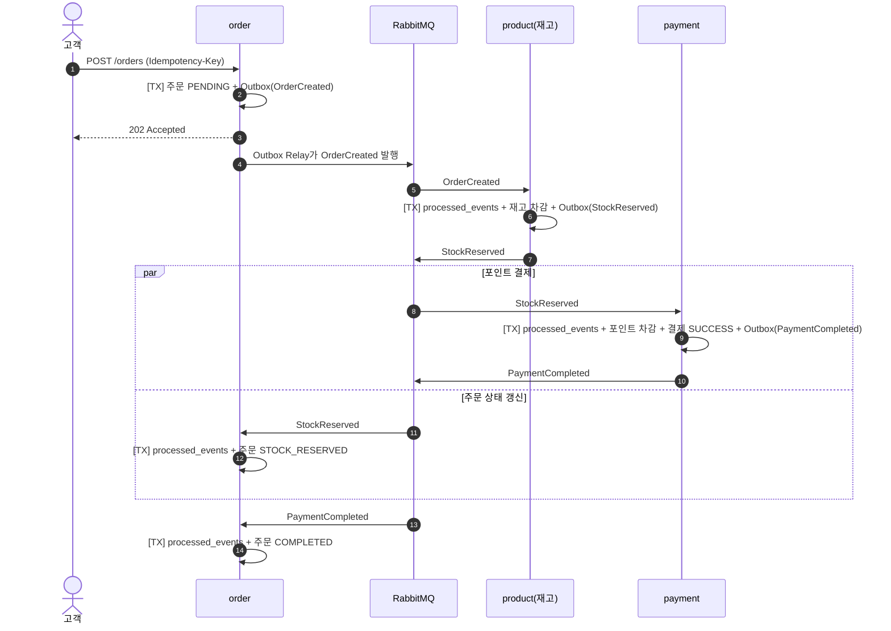
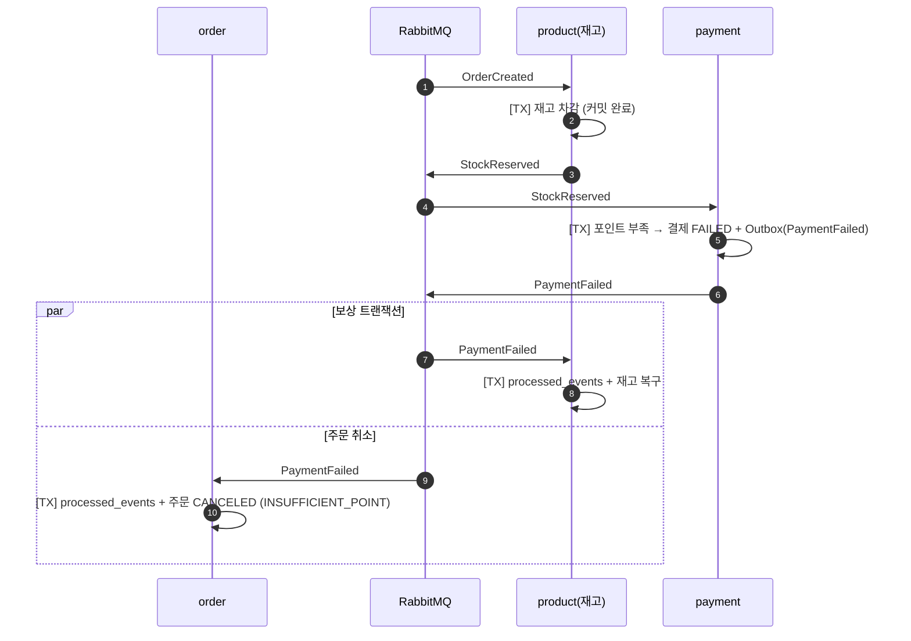
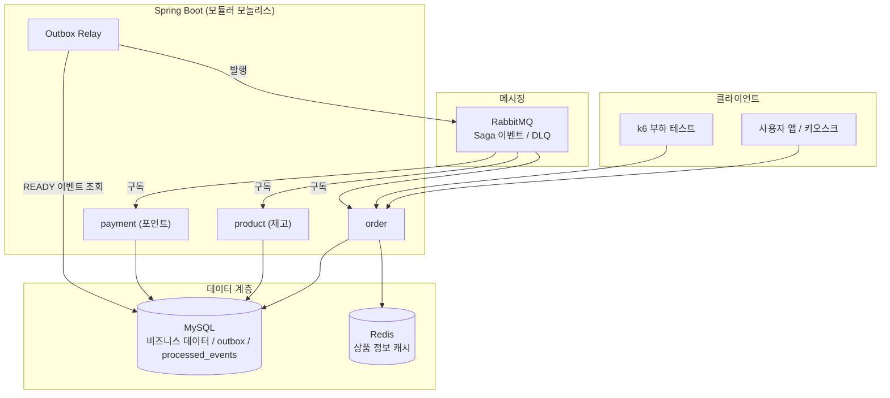

# Mega-Traffic Order API — 마스터 스펙 문서 (v2)

> 대형 카페(메가커피 스타일) 주문/결제 백엔드. 동시 주문 상황에서 **재고·포인트 정합성**을 지키고, 비동기 분산 흐름에서 **보상 트랜잭션(Saga)** 과 **멱등성**을 구현하는 것이 목표.

---

## 1. 프로젝트 개요

### 1.1 목표

| 구분 | 내용 |
|---|---|
| 핵심 문제 | 동시 주문이 몰릴 때 재고 초과 판매, 포인트 중복 차감, 메시지 중복/유실로 인한 데이터 불일치 |
| 해결 방향 | 단계별 로컬 트랜잭션 + 이벤트 기반 Saga, 보상 트랜잭션, Transactional Outbox, 멱등성 컨슈머 |
| 기간 | 2주 |

### 1.2 성공 기준 (검증 가능한 지표)

"초당 N건 처리" 같은 처리량 목표 대신, 로컬 환경에서도 검증 가능한 **정합성 지표**를 기준으로 삼는다.

- 동시 사용자 X명이 재고 N개 상품을 주문할 때 **초과 판매 0건**, **재고 음수 0건**
- 결제 실패 시 **차감된 재고가 100% 복구**
- 같은 메시지가 중복 전달돼도 **재고/포인트 변경은 1회만** 반영
- 같은 주문 요청이 재전송돼도 **주문은 1건만** 생성
- 처리량(TPS)과 응답 시간은 부하 테스트에서 **측정값과 테스트 조건을 함께** 기록 (목표치로 선언하지 않음)

### 1.3 아키텍처: 모듈러 모놀리스

- 초기부터 물리적 MSA로 나누면 네트워크·인프라 관리 비용이 커지므로, **하나의 애플리케이션 안에서 도메인 패키지를 엄격히 분리**한다.
- 도메인 간 호출은 **직접 메서드 호출이 아닌 이벤트(RabbitMQ)** 로만 한다. 향후 서버 분리 시 메시징 경계를 그대로 유지할 수 있다.
- 단일 MySQL을 사용하지만, **각 Saga 단계는 독립된 로컬 트랜잭션으로 커밋**한다. 그래야 앞 단계를 되돌리는 보상 트랜잭션이 실제로 의미를 가진다.

---

## 2. 기술 스택

| 분류 | 기술 |
|---|---|
| Language / Framework | Java 21, Spring Boot 3.5.16, Spring Data JPA, Validation, Lombok |
| Build | Gradle 9.7.1 (Gradle Wrapper) |
| Database | MySQL 8.4 (Docker Compose) |
| Cache | Redis 7.4 (상품 정보 캐시) — 동시성 비교 실험 시 Redisson 분산 락 |
| Message Queue | RabbitMQ 4.0 (Saga 이벤트, 재시도, DLQ) |
| Load Test | k6 |
| 실행 환경 | 로컬 Docker Compose (MySQL, Redis, RabbitMQ) |

**범위 제외 (2주 이후 확장)**: Nginx/ALB, AWS 배포, Prometheus/Grafana, nGrinder/JMeter

### 2.1 로컬 실행

```bash
cp .env.example .env    # 값 채우기 (compose.yaml과 application.yml이 함께 사용)
docker compose up -d    # MySQL, Redis, RabbitMQ 실행
./gradlew bootRun       # 반드시 프로젝트 루트에서 실행 (.env 경로 기준)
```

| 서비스 | 호스트 포트 | 비고 |
|---|---|---|
| MySQL | 3307 | DB `mega_order`, utf8mb4, Asia/Seoul |
| Redis | 6379 | AOF 활성화 |
| RabbitMQ | 5672 / 15672 | AMQP / 관리 UI (http://localhost:15672) |

- `.env`는 git에 올리지 않는다. 키 목록은 `.env.example` 참고.
- 데이터는 Docker volume에 유지된다. 초기화하려면 `docker compose down -v`.

---

## 3. REST API 명세

| 기능 | Method | Endpoint | 설명 |
|---|---|---|---|
| 테스트 데이터 | POST | `/api/v1/users` | 테스트용 유저 등록 |
| 테스트 데이터 | POST | `/api/v1/users/{userId}/points` | 포인트 충전 |
| 테스트 데이터 | POST | `/api/v1/products` | 상품 및 초기 재고 등록 |
| 포인트 조회 | GET | `/api/v1/users/{userId}/points` | 테스트 결과 검증용 잔액 조회 |
| 상품 조회 | GET | `/api/v1/products/{productId}` | 상품 정보 조회 (이름/가격은 캐시, **재고는 DB 조회**) |
| 주문 접수 | POST | `/api/v1/orders` | 주문 생성 후 `PENDING` 저장, 이후 결제는 비동기 처리 |
| 주문 상태 | GET | `/api/v1/orders/{orderId}/status` | 비동기 처리 결과 폴링 |

> 기존 `POST /api/v1/payments`는 제거. 결제는 클라이언트가 호출하지 않고 **이벤트로 진행**된다.

> `POST /api/v1/experiments/stock/{strategy}`는 재고 차감 방식(`none`, `atomic`, `pessimistic`, `optimistic`, `redisson`)을 비교하기 위한 **실험용 API**다. 실제 주문 흐름에서는 쓰지 않는다. (6.5 참고)

### 3.1 주문 접수 상세

**Request**

```
POST /api/v1/orders
Idempotency-Key: 7f3c2a1e-...   (클라이언트가 요청마다 생성하는 UUID)
```

```json
{
  "userId": 1,
  "items": [
    { "productId": 7, "quantity": 2 },
    { "productId": 9, "quantity": 1 }
  ]
}
```

**Response `202 Accepted`**

```json
{
  "orderId": 123,
  "status": "PENDING"
}
```

- 같은 `Idempotency-Key`로 재요청이 오면 새 주문을 만들지 않고 **기존 주문을 그대로 반환**한다.
- 주문 금액은 클라이언트 값이 아닌 **서버에서 상품 가격으로 계산**한다.

### 3.2 주문 상태 응답

```json
{
  "orderId": 123,
  "status": "CANCELED",
  "cancelReason": "INSUFFICIENT_POINT"
}
```

---

## 4. 데이터베이스 설계 (DBML)

```dbml
Table users {
  id bigint [pk, increment]
  name varchar(50) [not null]
  point_balance decimal(12,2) [not null, default: 0]
  created_at datetime [not null]
  updated_at datetime [not null]
}

Table products {
  id bigint [pk, increment]
  name varchar(100) [not null]
  price decimal(12,2) [not null]
  stock_quantity int [not null]
  created_at datetime [not null]
  updated_at datetime [not null]
}

Table orders {
  id bigint [pk, increment]
  user_id bigint [not null]
  idempotency_key varchar(64) [not null, unique]
  total_price decimal(12,2) [not null]
  status varchar(20) [not null]         // PENDING, STOCK_RESERVED, COMPLETED, CANCELED
  cancel_reason varchar(50)             // OUT_OF_STOCK, INSUFFICIENT_POINT
  created_at datetime [not null]
  updated_at datetime [not null]
}

Table order_items {
  id bigint [pk, increment]
  order_id bigint [not null]
  product_id bigint [not null]
  quantity int [not null]
  unit_price decimal(12,2) [not null]   // 주문 시점 가격 스냅샷
}

Table payments {
  id bigint [pk, increment]
  order_id bigint [not null, unique]
  amount decimal(12,2) [not null]
  status varchar(20) [not null]         // SUCCESS, FAILED
  failed_reason varchar(255)
  created_at datetime [not null]
}

Table outbox_events {
  id bigint [pk, increment]
  event_id varchar(36) [not null, unique]  // UUID, 컨슈머 멱등성 키로 사용
  aggregate_type varchar(30) [not null]    // ORDER, STOCK, PAYMENT
  aggregate_id bigint [not null]
  event_type varchar(50) [not null]
  payload text [not null]                 // json 타입은 소수를 double로 바꿔 저장하므로 원문 그대로 저장하려고 text 사용
  status varchar(20) [not null]            // READY, PUBLISHED
  created_at datetime [not null]
  published_at datetime

  indexes {
    (status, created_at) [name: 'idx_outbox_status_created']  // Relay의 READY 이벤트 조회용
  }
}

Table processed_events {
  id bigint [pk, increment]
  consumer varchar(50) [not null]          // 예: STOCK_RESERVE, STOCK_RESTORE
  event_id varchar(36) [not null]
  processed_at datetime [not null]

  indexes {
    (consumer, event_id) [unique]
  }
}

Ref: orders.user_id > users.id
Ref: order_items.order_id > orders.id
Ref: order_items.product_id > products.id
Ref: payments.order_id - orders.id
```

**설계 포인트**

- `orders.idempotency_key` unique: API 중복 요청 방어
- `processed_events (consumer, event_id)` unique: 컨슈머 중복 처리 방어. **같은 이벤트를 여러 컨슈머가 받을 수 있으므로** `event_id` 단독이 아니라 컨슈머 이름과 묶는다
- `order_items.unit_price`: 주문 이후 상품 가격이 바뀌어도 주문 금액이 흔들리지 않도록 스냅샷
- `orders.user_id`, `order_items.product_id`, `payments.order_id`는 도메인 간 결합을 낮추기 위해 ID만 저장하고 물리 FK를 두지 않는다. `order_items.order_id`만 실제 FK
- `created_at` / `updated_at`: `BaseTimeEntity`(JPA Auditing)를 상속한 엔티티는 자동으로 기록된다
- `users.point_balance` 기본값 0은 엔티티(Builder)에서 채운다. DDL에는 `DEFAULT 0`이 없으므로 SQL 직접 INSERT 시 값을 명시한다

---

## 5. Saga 흐름 (Choreography)

### 5.1 단계와 보상

| 단계 | 담당 도메인 | 로컬 트랜잭션 | 성공 이벤트 | 실패 이벤트 | 보상 |
|---|---|---|---|---|---|
| 1. 주문 생성 | order | 주문 `PENDING` 저장 | `OrderCreated` | - | - |
| 2. 재고 예약 | product | 주문 상품 전체 재고 차감 | `StockReserved` | `StockReserveFailed` | 없음 (한 트랜잭션에서 전부 롤백) |
| 2-1. 예약 반영 | order | `StockReserved` 구독 → 주문 `STOCK_RESERVED` | - | - | - |
| 3. 포인트 결제 | payment | 포인트 차감 + 결제 기록 | `PaymentCompleted` | `PaymentFailed` | **재고 복구** |
| 4. 주문 확정 | order | 주문 `COMPLETED` (`PENDING` 또는 `STOCK_RESERVED`에서) | - | - | - |

- 2단계는 이미 커밋된 상태에서 3단계가 실패할 수 있다. 이때 **재고 복구가 보상 트랜잭션**이 된다.
- 재고 복구 수량은 이벤트 payload에 담긴 상품 ID와 수량 목록을 기준으로 한다. product 도메인이 order 테이블을 직접 조회하지 않기 위함이다.
- 주문 확정은 `PENDING` 또는 `STOCK_RESERVED` 상태에서 가능하다. 메시지 도착 순서가 보장되지 않아 `PaymentCompleted`가 `StockReserved`보다 먼저 도착할 수 있기 때문이다.

### 5.2 성공 흐름



### 5.3 실패 흐름 (포인트 부족 → 보상)



재고 부족(`StockReserveFailed`)인 경우에는 되돌릴 커밋이 없으므로 주문만 `CANCELED (OUT_OF_STOCK)` 처리한다.

---

## 6. 데이터 정합성 설계

### 6.1 이벤트 유실 방지 — Transactional Outbox

- 문제: DB 커밋 후 MQ 발행 전에 서버가 죽으면 이벤트가 사라진다.
- 해결: 비즈니스 데이터와 `outbox_events`를 **같은 트랜잭션**에 저장하고, 별도 Relay(`@Scheduled` 폴링)가 `READY` 이벤트를 발행한 뒤 `PUBLISHED`로 바꾼다.
- 결과: 발행이 실패하거나 Relay가 두 번 발행할 수 있다 → **중복은 6.2에서 방어**한다.

### 6.2 중복 처리 방지 — 멱등성 컨슈머

- 문제: RabbitMQ는 at-least-once 전달이라 같은 메시지가 두 번 올 수 있다.
- 해결: 컨슈머는 한 트랜잭션 안에서
  1. `processed_events`에 `(consumer, event_id)` INSERT
  2. 비즈니스 로직 수행
- 같은 이벤트가 다시 오면 unique 제약 위반 → 롤백 후 건너뛴다.
- **Redis(SET NX)가 아닌 MySQL에 기록하는 이유**: Redis 키 저장과 MySQL 재고 변경은 한 트랜잭션으로 묶이지 않는다. 처리 도중 서버가 죽으면 Redis 키만 남아 재전송된 메시지가 무시되고, 재고는 영영 반영되지 않는다. 같은 DB에 두면 둘이 함께 커밋되거나 함께 롤백된다.

### 6.3 메시지 처리 실패 — ack / 재시도 / DLQ

- 컨슈머는 **처리 완료 후 ack** 한다. 처리 중 서버가 죽으면 ack가 가지 않아 RabbitMQ가 재전송한다.
- 일시적 오류는 재시도 N회 후 **DLQ(Dead Letter Queue)** 로 이동해 수동 확인한다.
- 잔액 부족·재고 부족은 재시도 대상이 아닌 **비즈니스 실패**로 보고 실패 이벤트를 발행한다.

### 6.4 API 중복 요청 방지

- `Idempotency-Key` 헤더를 `orders.idempotency_key`(unique)에 저장한다.
- 중복 INSERT 시 기존 주문을 조회해 같은 응답을 돌려준다.

### 6.5 재고·포인트 동시성 제어

컨슈머가 여러 스레드로 동작하면 같은 상품 재고를 동시에 차감할 수 있다. 아래 방식들을 같은 조건에서 k6로 비교한 결과, **원자적 조건부 UPDATE로 결정했다.**

| 방식 | 개요 |
|---|---|
| 원자적 조건부 UPDATE (**채택**) | `UPDATE ... SET stock = stock - ? WHERE id = ? AND stock >= ?`, 영향받은 행 수로 성공 판단 |
| 비관적 락 | `SELECT ... FOR UPDATE` 후 차감 |
| 낙관적 락 | `@Version` + 충돌 시 재시도 |
| Redisson 분산 락 | 상품 ID 단위 락 획득 후 차감 |

#### 측정 요약 (시나리오 B: 재고 100000, VU 100명 × 30초, 3회 중앙값)

| 방식 | 정합성 판정 | RPS | p95 (ms) | 성공 / 503 |
|---|---|---|---|---|
| 보호 없음 (none, 비교 기준) | **FAIL** (성공 7501건 중 실제 차감 751건) | 246.7 | 450 | 7501 / 0 |
| 원자적 조건부 UPDATE | PASS | **251.7** | 431 | 7648 / 0 |
| 비관적 락 | PASS | 193.6 | 632 | 5899 / 0 |
| 낙관적 락 | PASS | 173.1 | 789 | 1887 / 3414 |
| Redisson 분산 락 | PASS | 102.5 | 1499 | 3164 / 0 |

- 정합성 판정은 "처음 재고 − 성공 수 = 남은 재고"와 "남은 재고 ≥ 0"을 모두 만족하는지 본다.
- 한정 수량 쟁탈 시나리오(A), 측정 조건, 회차별로 값이 흔들린 항목은 [loadtest/RESULTS.md](loadtest/RESULTS.md)에 있다.

#### 결정 근거

1. **정합성을 지킨 방식 중 처리량이 가장 높다.** RPS 251.7로, 비관적 락(193.6)·낙관적 락(173.1)·분산 락(102.5)보다 높다.
2. **정합성을 지키는 비용이 사실상 없다.** 보호 없는 방식(246.7)과 처리량이 같은 수준이다.
3. **구현이 단순하다.** 락 장치나 재시도 코드 없이 SQL 한 문장으로 끝난다.

#### 다른 방식이 맞는 상황

- **비관적 락**: 조건 하나로 표현할 수 없는 규칙을 확인한 뒤 바꿔야 할 때
- **낙관적 락**: 충돌이 드문 곳. 한 행에 요청이 몰리면 약 65%가 실패했다(B에서 총 5253건 중 503이 3414건).
- **분산 락**: 여러 서버가 DB 밖의 자원까지 묶어서 순서를 지켜야 할 때

#### 적용 규칙

- 포인트 차감도 같은 방식(조건부 UPDATE: 잔액 ≥ 금액)을 써서 음수 잔액을 막는다.
- 한 주문에 상품이 여러 개면 **상품 ID 오름차순으로 차감**한다. 모든 트랜잭션이 같은 순서로 행 락을 잡게 해서 데드락을 막는다.

### 6.6 캐시 정책

- 캐시 대상: 상품 이름·가격 (Cache-Aside, TTL 적용)
- **재고는 캐시하지 않는다.** 결제마다 바뀌는 값이라 캐시하면 정합성이 깨진다.

### 6.7 알려진 한계

- **Outbox Relay는 서버 1대를 가정한다.** 서버 여러 대가 동시에 Relay를 돌리면 같은 `READY` 이벤트를 각자 발행할 수 있다. 여러 대로 늘릴 때는 `SELECT ... FOR UPDATE SKIP LOCKED` 등으로 조회 대상을 나눠야 한다.

---

## 7. 시스템 아키텍처



---

## 8. 패키지 구조

```
com.mega.order
 ┣ MegaApplication.java
 ┣ global
 ┃  ┣ BaseTimeEntity.java  // createdAt / updatedAt 자동 관리 (JPA Auditing)
 ┃  ┣ config          // Redis, RabbitMQ(Exchange/Queue/DLQ), JPA(JpaConfig: @EnableJpaAuditing)
 ┃  ┣ exception       // 전역 예외 처리
 ┃  ┣ outbox          // OutboxEvent 엔티티, 저장 헬퍼, Relay 스케줄러
 ┃  ┗ idempotency     // ProcessedEvent 엔티티, 중복 체크 헬퍼
 ┣ user               // 회원, 포인트 조회/충전, 포인트 차감 창구(PointDeductor)
 ┣ product            // 상품, 재고 예약/복구
 ┃  ┗ messaging       // OrderCreated, PaymentFailed 컨슈머
 ┣ order              // 주문 접수, 상태 조회, 확정/취소
 ┃  ┗ messaging       // StockReserved, PaymentCompleted, PaymentFailed, StockReserveFailed 컨슈머
 ┗ payment            // 포인트 차감, 결제 기록
    ┗ messaging       // StockReserved 컨슈머
```

- 각 도메인은 `controller / service / repository / entity`를 가진다.
- **도메인 간 서비스 직접 호출 금지.** 다른 도메인에 영향을 주는 작업은 이벤트로만 전달한다. 단, 읽기는 각 도메인이 제공하는 Reader를 통해 허용한다. 상태 변경은 이벤트로만 한다.
- **예외: 포인트 차감.** 포인트 차감은 user가 제공하는 `PointDeductor`를 통해 payment가 수행한다. 차감과 결제 기록이 한 트랜잭션으로 묶여야 하기 때문이다. 다른 도메인이 user 상태를 바꾸는 창구는 이것 하나로 제한한다. 물리적으로 서버를 나누면 포인트 잔액은 payment 서비스로 옮긴다.

---

## 9. 2주 일정

| 주차 | 일정 | 산출물 |
|---|---|---|
| 1주차 | Day 1–2 | Docker Compose, 엔티티/ERD, 테스트 데이터 API |
| | Day 3–4 | 주문 접수 + Idempotency-Key, 재고 차감 동시성 방식 4종 + 비교 기준(보호 없음) 구현 |
| | Day 5–7 | k6 동시성 비교 테스트, 방식 결정 및 근거 기록 |
| 2주차 | Day 8–9 | RabbitMQ 연결, Outbox + Relay, Saga 성공 흐름 |
| | Day 10–11 | 실패 흐름 + 보상 트랜잭션, 멱등성 컨슈머, 재시도/DLQ |
| | Day 12–13 | 정합성 검증 테스트 (중복 메시지 주입, 서버 강제 종료, 포인트 부족 시나리오) |
| | Day 14 | README, 트러블슈팅 정리, 회고 |

### 확장 과제 (시간이 남으면)

- `PENDING` 상태로 오래 멈춘 주문 타임아웃 처리
- 처리 완료된 `outbox_events`, `processed_events` 정리 배치
- Prometheus/Grafana 모니터링, AWS 배포

---

## 10. 트러블슈팅

### 10.1 부하 테스트 중 연결 거부

- **증상**
  - k6로 연결 200개를 동시에 열면(재고 차감 시나리오 A), 일부 요청이 서버에 닿지 못했다.
  - k6 로그: `connectex: No connection could be made because the target machine actively refused it.`
  - 간헐적으로 발생했다. 200건 중 49~76건이 실패했고, 예열을 마친 뒤에도 나왔다.
- **원인 추정**
  - Tomcat의 연결 대기열(`server.tomcat.accept-count`)은 기본값이 100이다. 연결이 한꺼번에 몰려 이 대기열이 넘친 것으로 본다.
  - Linux는 넘친 연결 요청을 버리고 클라이언트가 다시 시도하게 하지만, Windows는 즉시 거부한다.
  - 대기열이 실제로 얼마나 찼는지는 측정하지 않았다. 다만 동시 연결이 100개인 시나리오 B에서는 한 번도 나오지 않았고, 아래 조치 뒤에 사라졌다.
- **조치**
  - `application.yml`에 `server.tomcat.accept-count: 1000`을 넣었다.
  - 이후 측정 30회에서 연결 실패는 0건이었다.
  - 자세한 기록은 [loadtest/RESULTS.md](loadtest/RESULTS.md#트러블슈팅)에 있다.
- **배운 점**
  - 트래픽이 몰리면 비즈니스 로직보다 **연결을 받는 단계가 먼저 막힐 수 있다.**
  - 부하 테스트에서는 응답 코드뿐 아니라 "요청이 서버에 닿았는지"도 따로 세어야 결과를 믿을 수 있다.
